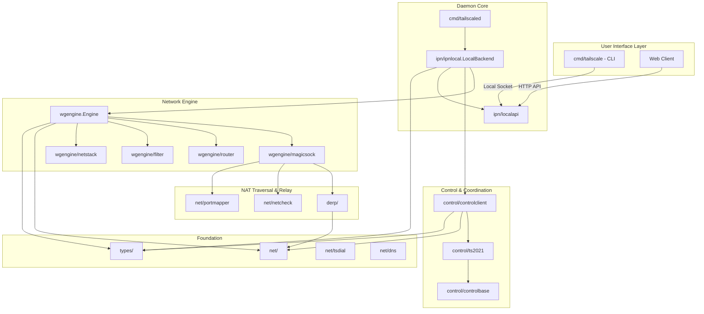
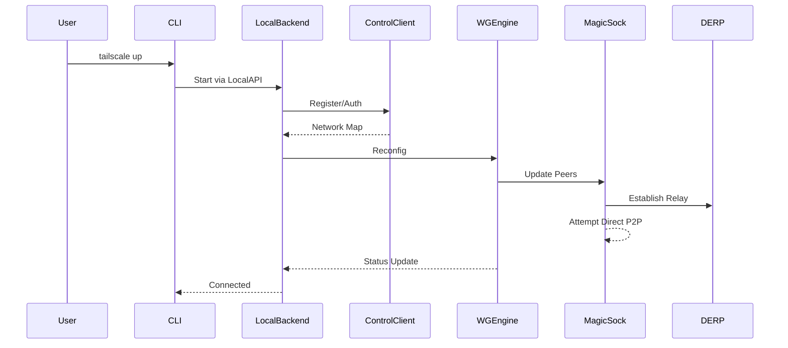

# Tailscale Code Graph

**Purpose:** This document provides a comprehensive architectural map of the Tailscale codebase, enabling AI agents and developers to understand the system structure, dependencies, and key workflows without extensive file exploration.

**Last Updated:** 2026-10-17

---

## Executive Summary

**Language:** Go 1.27.2  
**Architecture:** Monorepo with daemon + CLI architecture  
**Core Components:** WireGuard engine, Control plane client, DERP relay, Network stack  
**Primary Entry Points:** `cmd/tailscaled` (daemon), `cmd/tailscale` (CLI)  
**Build System:** Makefile + custom Go toolchain wrapper (`./tool/go`)

---

## Table of Contents

- [A. Visual Architecture](#a-visual-architecture)
- [B. Structured Code Graph Index](#b-structured-code-graph-index)
- [C. Data Flow Patterns](#c-data-flow-patterns--architectural-invariants)
- [D. Gotchas & Pitfalls](#d-gotchas--pitfalls)
- [E. Testing Commands](#e-testing-commands--execution-workflows)
- [F. Quick Reference by Task](#f-quick-reference-key-files-by-task)
- [G. External Integrations](#g-external-integration-points)
- [H. Security Model](#h-security-model)
- [I. Performance Characteristics](#i-performance-characteristics)
- [J. Development Workflow](#j-development-workflow)
- [K. Debugging](#k-common-debugging-scenarios)

---

## A. Visual Architecture

### High-Level System Architecture



### Data Flow: Connection Establishment



---

## B. Structured Code Graph Index

### Core Entry Points

#### **cmd/tailscaled/**
- **Role:** Main daemon process; orchestrates all Tailscale functionality
- **Key File:** `tailscaled.go`
- **Exports:** `main()` - daemon entry point
- **Dependencies:** `ipn/ipnlocal`, `ipn/ipnserver`, `wgengine`, `control/controlclient`, `net/tstun`, `tsd`
- **Incoming References:** System service managers, Docker, package managers
- **Key Functions:**
  - `main()` → Parses flags, initializes system (tun device, state store, logging), creates LocalBackend, starts IPN server
  - `defaultTunName()` → Returns platform-specific TUN device name
  - Signal handling for graceful shutdown

#### **cmd/tailscale/cli/**
- **Role:** Command-line interface for controlling the daemon
- **Key File:** `cli.go`
- **Exports:** CLI commands via `ffcli` framework
- **Dependencies:** `client/local`, `ipn`, various CLI subcommands
- **Incoming References:** End users, scripts, automation tools
- **Key Functions:**
  - `RunWithContext()` → Main CLI entry point, dispatches to subcommands
  - `localClient` → Communicates with daemon via Unix socket or named pipe

---

### IPN (Inter-Process Network) Layer

#### **ipn/ipnlocal/local.go**
- **Role:** Heart of the Tailscale node agent; coordinates all subsystems
- **Key Type:** `LocalBackend` - main state machine
- **Exports:** `NewLocalBackend()`, `LocalBackend` type
- **Dependencies:** `wgengine`, `control/controlclient`, `net/dns`, `net/netmon`, `tailcfg`, `types/netmap`, extensive util packages
- **Incoming References:** `cmd/tailscaled`, `ipn/localapi`, `ipn/ipnserver`
- **Key Methods:**
  - `NewLocalBackend()` → Creates and initializes the backend
  - `Start()` → Begins backend operation
  - `EditPrefs()` → Handles preference changes
  - `SetNotifyCallback()` → Registers state change notifications
  - `Reconfig()` → Reconfigures WireGuard engine from network map

#### **ipn/localapi/localapi.go**
- **Role:** HTTP API server for local control (CLI, Web UI)
- **Key Type:** `Handler`
- **Exports:** HTTP handler implementation
- **Dependencies:** `ipn/ipnlocal`, `ipn`, `tailcfg`
- **Key Endpoints:**
  - `/localapi/v0/status`, `/localapi/v0/prefs`, `/localapi/v0/start`, `/localapi/v0/logout`, `/localapi/v0/cert/*`

#### **ipn/prefs.go**
- **Role:** User and device preference management
- **Key Type:** `Prefs` struct
- **Exports:** Preferences data structure and serialization
- **Key Fields:** WantRunning, LoggedOut, ControlURL, ExitNodeID, AdvertiseRoutes

---

### WireGuard Engine Layer

#### **wgengine/wgengine.go**
- **Role:** WireGuard engine interface definition
- **Key Type:** `Engine` interface
- **Key Methods:** `Reconfig()`, `GetFilter()`, `SetFilter()`, `PeerForIP()`, `Ping()`, `Close()`

#### **wgengine/userspace.go**
- **Role:** Main userspace WireGuard engine implementation
- **Key Type:** `userspaceEngine`
- **Exports:** `NewUserspaceEngine()` factory
- **Dependencies:** `wgengine/router`, `wgengine/magicsock`, `net/tstun`, `net/dns`, WireGuard-go

#### **wgengine/magicsock/**
- **Role:** "Magic" socket for NAT traversal and multi-path connectivity
- **Key Type:** `Conn`
- **Key Features:**
  - Simultaneous use of multiple network paths
  - DERP relay fallback
  - NAT traversal via STUN/ICE-like protocol
  - Endpoint discovery and optimization

#### **wgengine/router/**
- **Role:** Platform-specific IP routing and forwarding configuration
- **Key Type:** `Router` interface
- **Implementations:** Per-OS (Linux, Darwin, Windows, etc.)

#### **wgengine/filter/**
- **Role:** Packet filtering based on Tailscale ACLs
- **Key Type:** `Filter`
- **Key Functions:** `CheckTCP()`, `CheckUDP()`, `CheckICMP()` → Filter decisions

---

### Control Plane Layer

#### **control/controlclient/**
- **Role:** Client interface for Tailscale control plane communication
- **Key Type:** `Client` interface, `Auto` implementation
- **Key Features:**
  - Automatic reconnection on failure
  - Handles authentication flows (OAuth, authkey)
  - Long-polling for network map updates

#### **control/ts2021/**
- **Role:** TS2021 control protocol (Noise-based secure channel)
- **Key Type:** `Client`
- **Key Features:** Noise_IK handshake, Machine authentication, Encrypted control channel

---

### DERP (Designated Encrypted Relay for Packets)

#### **derp/derp.go**
- **Role:** DERP protocol implementation (relay server logic)
- **Key Types:** `Server`, protocol frame definitions
- **Key Features:** Encrypted packet relay when direct P2P fails

#### **derp/derp_client.go**
- **Role:** DERP client implementation
- **Key Type:** `Client`
- **Key Functions:** `Send()`, `Recv()`, keep-alive

#### **cmd/derper/**
- **Role:** Standalone DERP relay server
- **Key Features:** Public DERP relay, Optional STUN server, TLS termination

---

### Network Utilities

#### **net/dns/**
- **Role:** DNS configuration and resolution
- **Key Features:** MagicDNS implementation, Split DNS, Per-OS DNS configuration

#### **net/netcheck/**
- **Role:** Network reachability and NAT traversal capability detection
- **Key Features:** STUN-based NAT type detection, DERP server reachability testing

#### **net/netmon/**
- **Role:** Network interface and route monitoring
- **Key Features:** Interface up/down events, IP address changes, Default route changes

#### **net/tstun/**
- **Role:** TUN device abstraction
- **Key Features:** Platform-agnostic TUN device interface, Packet filtering integration

---

### Types & Data Structures

#### **types/netmap/**
- **Role:** Network map representation (node graph, routes, DNS config)
- **Key Type:** `NetworkMap`
- **Note:** Central data structure received from control plane

#### **types/key/**
- **Role:** Cryptographic key types
- **Exports:** `NodePublic`, `NodePrivate`, `MachinePublic`, `MachinePrivate`, `DiscoPublic`, `DiscoPrivate`

#### **tailcfg/tailcfg.go**
- **Role:** Control protocol types and configuration messages
- **Key Types:** `Node`, `User`, `Hostinfo`, `NetInfo`, `RegisterRequest`, `MapResponse`
- **Note:** Large file (3000+ lines), central protocol definition

---

### Client Libraries

#### **client/local/**
- **Role:** Go client library for local daemon API
- **Key Type:** `Client`
- **Key Methods:** `Status()`, `EditPrefs()`, `Start()`, `BugtrackerURL()`

#### **tsnet/**
- **Role:** Library for embedding Tailscale in applications
- **Key Type:** `Server`
- **Key Features:** Create tailnet nodes programmatically, Dial and listen within tailnet

---

## C. Data Flow Patterns & Architectural Invariants

### Startup Flow

1. **tailscaled starts** → Reads state from persistent store → Initializes `tsd.System`
2. **Creates LocalBackend** → Initializes control client, WireGuard engine
3. **LocalBackend.Start()** → Connects to control plane if `WantRunning=true`
4. **Control client authenticates** → Receives initial network map
5. **LocalBackend.Reconfig()** → Pushes network map to WireGuard engine
6. **WireGuard engine configures** → Sets up peers, routes, DNS
7. **MagicSock establishes connections** → Direct P2P or DERP relay
8. **Ready state** → Node is connected to tailnet

### Network Map Update Flow

1. Control plane change (new peer, ACL update, DNS change)
2. Control client receives MapResponse via long-poll
3. LocalBackend processes NetworkMap → Determines what changed
4. LocalBackend.Reconfig() → Calls Engine.Reconfig() with new config
5. Engine updates → WireGuard peers, router config, DNS config
6. Status callbacks fire → CLI/UI updates

### Architectural Invariants

1. **Single Backend Per Process** - LocalBackend is a singleton within the daemon
2. **Immutable Network Map** - NetworkMap is read-only after construction; updates create new instances
3. **Lazy Connection** - MagicSock doesn't connect to peers until traffic is sent
4. **DNS First** - MagicDNS queries resolved locally before external DNS
5. **DERP Fallback** - Direct connections preferred, DERP used when P2P fails
6. **State Persistence** - Node keys, machine keys, preferences persisted to disk
7. **Event-Driven Updates** - Network changes trigger callbacks, not polling
8. **Concurrent Safety** - Heavy use of mutexes; most public APIs are thread-safe

---

## D. Gotchas & Pitfalls

### 1. Go Toolchain Version Lock
- **Issue:** Must use exact Go version specified in `go.toolchain.version`
- **Files:** `go.toolchain.version`, `go.toolchain.rev`, `go.toolchain.branch`
- **Mitigation:** Always use `./tool/go` instead of system `go`

### 2. Generated Code
- **Issue:** Many files are auto-generated and should not be manually edited
- **Patterns:** Files ending in `_clone.go`, `_view.go`, `_string.go`
- **Mitigation:** Edit source types, then run `go generate ./...`

### 3. Build Tags Matter
- **Issue:** Different build tags enable/disable major features
- **Key Tags:** `ts_omit_aws`, `ts_omit_bird`, `ts_include_cli`, feature flags
- **Check:** `cmd/featuretags` for feature matrix

### 4. TUN Device Permissions
- **Issue:** TUN device creation requires elevated privileges on most platforms
- **Impact:** Daemon must run as root or with `CAP_NET_ADMIN`

### 5. State Directory
- **Issue:** State in `/var/lib/tailscale` (Linux) must persist across restarts
- **Impact:** Loss of state causes re-registration, new machine key
- **Critical Files:** `tailscaled.state` (encrypted with machine key)

### 6. Cross-Compilation Traps
- **Issue:** Platform-specific code in `net/`, `wgengine/router/`, system integration
- **Mitigation:** Test on actual target OS, check build tags

### 7. Coordination Server Dependency
- **Issue:** Cannot function without reachable control plane
- **Impact:** Offline nodes cannot establish new connections
- **Mitigation:** Headscale for self-hosted control plane

---

## E. Testing Commands & Execution Workflows

### Quick Verification
```bash
# Run all tests (fast)
./tool/go test ./...

# Run tests with race detector
./tool/go test -race ./...

# Run specific package
./tool/go test ./ipn/ipnlocal

# Run specific test function
./tool/go test ./ipn/ipnlocal -run TestLocalBackendAuth
```

### Code Quality Checks
```bash
# Run all checks (vet, staticcheck, lint, depaware)
make check

# Go vet
make vet
./tool/go vet ./...

# Static analysis
make staticcheck

# Linting (golangci-lint)
make lint

# Dependency analysis
make depaware
```

### Build Commands
```bash
# Build daemon and CLI
./tool/go install tailscale.com/cmd/tailscale{,d}

# Build with version info (for releases)
./build_dist.sh tailscale.com/cmd/tailscaled
./build_dist.sh tailscale.com/cmd/tailscale

# Build for specific platform
GOOS=linux GOARCH=amd64 ./tool/go build ./cmd/tailscaled
GOOS=windows GOARCH=amd64 make buildwindows
```

### Module Maintenance
```bash
# Tidy dependencies
make tidy
./tool/go mod tidy

# Update dependencies
make updatedeps

# Generate all code
./tool/go generate ./...
```

---

## F. Quick Reference: Key Files by Task

### Adding a New API Endpoint
**Files to Edit:**
1. `ipn/localapi/localapi.go` - Add HTTP handler
2. `client/local/local.go` - Add client method (optional)
3. `cmd/tailscale/cli/*.go` - Add CLI command (if user-facing)

**Testing:**
```bash
./tool/go test ./ipn/localapi -run TestYourEndpoint
```

### Modifying Network Configuration
**Files to Edit:**
1. `tailcfg/tailcfg.go` - Protocol structures (if control plane changes)
2. `types/netmap/netmap.go` - Network map representation
3. `ipn/ipnlocal/local.go` - LocalBackend processing
4. `wgengine/userspace.go` - Engine reconfiguration
5. `wgengine/router/*` - Platform-specific route setup

### Adding CLI Command
**Files to Edit:**
1. `cmd/tailscale/cli/` - New file or existing command file
2. `cmd/tailscale/cli/cli.go` - Register command in root
3. `client/local/local.go` - Add API client method (if needed)

### Modifying WireGuard Behavior
**Files to Edit:**
1. `wgengine/userspace.go` - Engine implementation
2. `wgengine/magicsock/magicsock.go` - Connection management
3. `wgengine/wgcfg/` - WireGuard configuration generation

### Changing DERP Behavior
**Files to Edit:**
1. `derp/derp.go` - Protocol implementation
2. `derp/derp_server.go` - Server logic
3. `cmd/derper/derper.go` - Server daemon
4. `wgengine/magicsock/magicsock.go` - Client usage

---

## G. External Integration Points

### Control Plane API
- **Endpoint:** `https://login.tailscale.com` (or custom control URL)
- **Protocol:** HTTP/2 over Noise (TS2021)
- **Auth:** Machine key + node key signatures

### DERP Servers
- **Default:** Tailscale-operated relay servers worldwide
- **Protocol:** Custom framed protocol over WebSocket
- **Discovery:** Via network map from control plane

### DNS Providers
- **MagicDNS:** Internal `.ts.net` resolution
- **System DNS:** Platform-specific integration (systemd-resolved, `/etc/resolv.conf`, etc.)

---

## H. Security Model

### Key Hierarchy
1. **Machine Key** - Identifies device to control plane (persisted, never shared)
2. **Node Key** - WireGuard private key for this node (persisted, rotatable)
3. **Disco Key** - Used for endpoint discovery (ephemeral)

### Trust Boundaries
- **Control Plane** - Trusted coordinator; signs node list
- **Peer Nodes** - Authenticated via WireGuard; ACLs enforced locally
- **DERP Relays** - Untrusted; end-to-end encrypted payload
- **Local System** - Daemon runs with privileges; local users can control via socket

### ACL Enforcement
- **Location:** `wgengine/filter/` enforces at packet level
- **Source:** Pushed from control plane as part of network map
- **Timing:** Checked on every packet before encryption (outbound) and after decryption (inbound)

---

## I. Performance Characteristics

### Memory Usage
- **Minimal (no routes):** ~30-50 MB RSS
- **With netstack (exit node):** +100-150 MB
- **Per peer overhead:** ~1-2 KB

### Latency
- **Direct P2P:** Near-optimal (limited by underlying network)
- **Via DERP:** +10-100ms depending on relay location
- **DNS (MagicDNS):** Sub-millisecond (local cache)

---

## J. Development Workflow

### Standard Development Cycle
1. Read `session.md` (if exists) for context
2. Make changes to source files
3. Run code generation if types changed: `./tool/go generate ./...`
4. Run tests for affected packages: `./tool/go test ./affected/package`
5. Run checks before commit: `make vet lint`
6. Build to verify: `./tool/go build ./cmd/tailscaled ./cmd/tailscale`

### Commit Guidelines
- See `docs/commit-messages.md`
- Include issue references (#1234)
- Require `Signed-off-by:` (DCO)
- Keep commits focused and atomic

---

## K. Common Debugging Scenarios

### Connection Issues
```bash
# Check status
./tailscale status

# Detailed peer info
./tailscale status --peers

# Network check (NAT traversal, DERP)
./tailscale netcheck

# Ping peer
./tailscale ping peer-name
```

### DNS Issues
```bash
# Check DNS config
./tailscale debug dns

# Query via MagicDNS
dig @100.100.100.100 peer-name.ts.net
```

### Performance Issues
```bash
# Profile CPU
./tailscale debug cpuprofile

# Profile memory
./tailscale debug memprofile
```

---

## L. Additional Commands & Tools

### Key Commands in cmd/
- **cmd/k8s-operator/** - Kubernetes operator for exposing services to tailnet
- **cmd/derper/** - DERP relay server
- **cmd/stund/** - STUN server
- **cmd/tsidp/** - OpenID Connect identity provider
- **cmd/containerboot/** - Container initialization wrapper
- **cmd/gitops-pusher/** - GitOps ACL automation
- **cmd/dist/** - Distribution package builder
- **cmd/featuretags/** - Build tag management

---

## M. Maintenance Notes

### This Document
- **Update trigger:** Significant architectural changes, new subsystems, major refactors
- **Scope:** High-level structure and relationships; not exhaustive API documentation
- **Audience:** AI agents, new contributors, architectural review

### Related Documentation
- **session.md** - Short-lived context for current work (create when needed)
- **ARCHITECTURE.md** - Deep architectural decisions (create if detailed rationale needed)
- **CONTRIBUTING.md** - Contribution workflow (create if formalizing process)

---

**END OF CODE_GRAPH.md**


